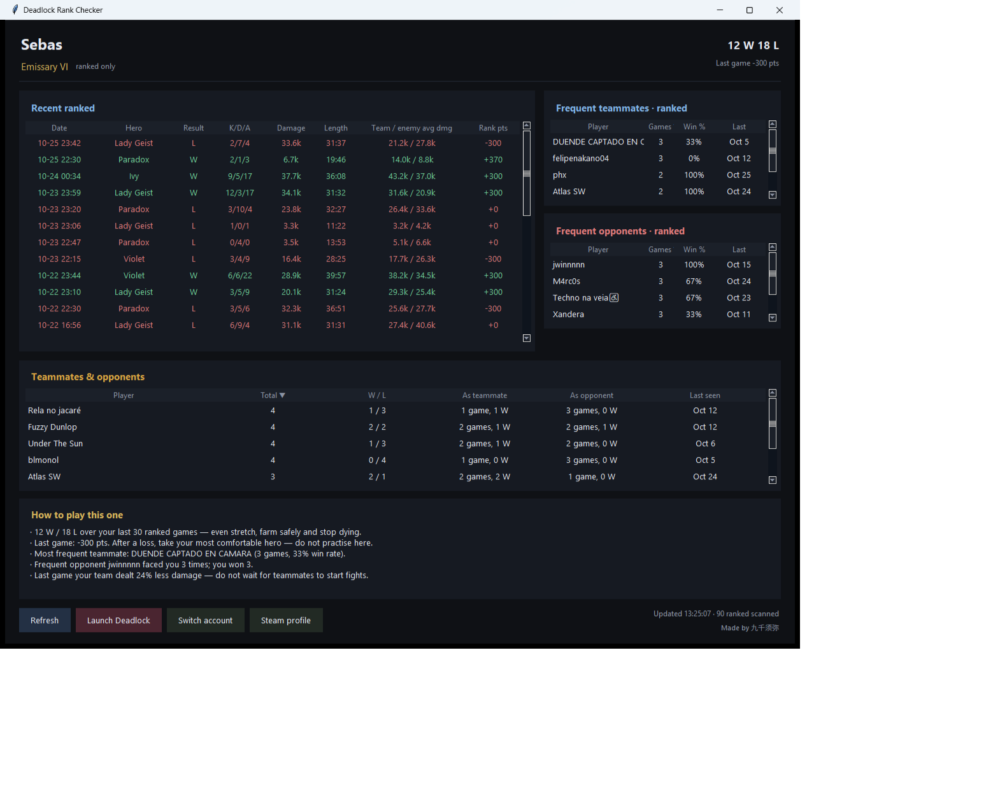

# Deadlock Rank Checker

[](../../releases/latest)
[](LICENSE)
[](../../releases/latest)
[](../../actions)

A tiny Windows desktop app that reads your **Deadlock ranked match history** and lays it out in one screen: rank progress, the last 30 ranked games, and — more usefully — **who you keep meeting**.

Built for the situation where you queue solo and wonder *"haven't I seen this guy before?"* The app keeps a rolling scan of your recent ranked games and shows teammates/opponents you have met more than once, how those games went, and when you last ran into them.

<p align="center">
  
</p>

> **It cannot tell you who you will be matched with next.** Matchmaking happens on Valve's servers and no public API exposes the queue. What this app shows is *historical* meeting statistics, not a prediction.

---

## Features

| Panel | What it shows |
|---|---|
| **Header** | Steam name, rank badge (e.g. `Emissary VI`), win/loss over the scanned window, points change of the last game |
| **Recent ranked** | Last 30 ranked games: date, hero, W/L, K/D/A, hero damage, match length, your team's average damage vs the enemy's, rank points |
| **Frequent teammates** | Players who were on your side more than once: games together, win rate, last meeting |
| **Frequent opponents** | Players who were against you more than once: games, your win rate against them, last meeting |
| **Teammates & opponents** | People you have met on *both* sides, with the split (`3 games as teammate / 2 as opponent`) |
| **Click a name** | Player names are links — clicking one opens that player's Steam profile in your browser |
| **How to play this one** | A few rule-based notes built from the numbers above — streaks, points swing, most frequent teammate, damage gap of the last game |

Every table is sortable (click a column header, click again to reverse) and scrollable. Default ordering is "met most often first".

## Install

1. Download the latest `DeadlockRankChecker-*-win64.zip` from [Releases](../../releases).
2. Extract anywhere (Desktop, `D:\Tools\`, …). **Do not** put it in `Program Files` — the app writes `config.json` and `cache\` next to the executable.
3. Run `DeadlockRankChecker.exe`.

Windows SmartScreen may warn about an unsigned executable: *More info → Run anyway*.

## First run

The app asks for your account. Any of these works:

```
76561198208137931                                   # SteamID64
247872203                                           # friend code / SteamID3 (8–10 digits)
https://steamcommunity.com/id/yourname              # profile URL (custom or /profiles/…)
```

It is stored in `config.json` next to the exe, so the next launch goes straight to the data. Use **Switch account** to change it.

## Requirements

- Windows 10/11 x64
- Internet access (no Steam login, no game files touched)

## Data source

All numbers come from [api.deadlock-api.com](https://api.deadlock-api.com) — a community REST API, no key required.

| Endpoint | Used for |
|---|---|
| `/v1/players/{id}/match-history` | ranked history (`match_mode == 4`), rank deltas |
| `/v1/players/{id}/rank` | badge, sub-rank, last game progress |
| `/v1/matches/metadata` (bulk) | per-player final stats: damage, net worth, healing |
| `/v1/players/steam` | Steam personas for the player tables |
| `/v1/assets/heroes` | hero names |

A game that just ended needs a few minutes before it shows up. If the API is rate-limited or Steam is busy, the app shows the HTTP status instead of pretending the network died.

## Limitations

- **Ranked only.** Normal / Street Brawl games are filtered out. An account with no ranked games shows an empty state.
- **30 games by default** (`"recent": 30` in `config.json`); the teammate/opponent trays scan the last 90 ranked games.
- **No MMR/rating endpoint exists** in the public API — the rank badge is the source of truth.
- **Advice is a rule engine**, not a language model. Six thresholds over your recent results; it changes with the account and the games, and it will not invent a story.

## Build from source

```bat
py -3.11 -m pip install --user pyinstaller
py -3.11 -m PyInstaller --noconfirm --onefile --noconsole --clean ^
    --name DeadlockRankChecker --distpath dist --workpath build --specpath build coach_en.py
```

`src/coach_en.py` is the English build, `src/coach.py` the Chinese one.

Pushing a `v*` tag rebuilds both executables on GitHub Actions and attaches them to a release (`.github/workflows/release.yml`). The workflow can also be started manually from the Actions tab — it uploads the zips as run artifacts without touching releases. Only Python's standard library is used at runtime (`tkinter`, `urllib`, `json`, `sqlite`-free).

The application icon is a Deadlock game asset and is therefore **not** included here; pass your own `--icon your.ico` if you rebuild.

## License

MIT — see [LICENSE](LICENSE). Not affiliated with Valve Corporation. Deadlock and all related assets belong to Valve.

---

Made by 九千须弥 · Chinese version: [死锁排位查询](https://github.com/XuMi66/deadlock-rank-checker/releases)
